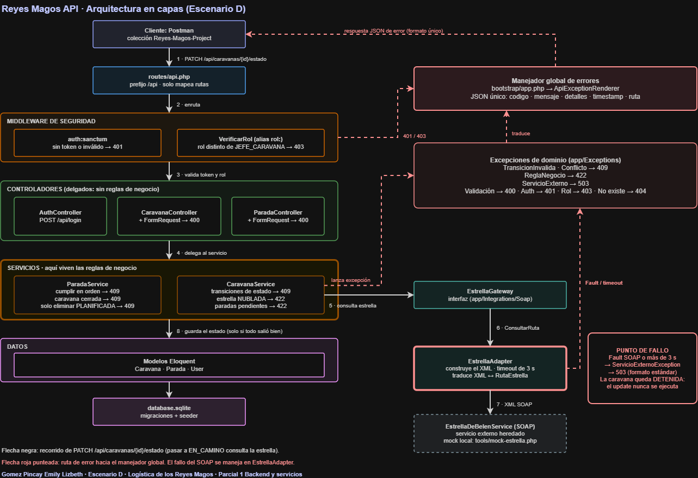

# Reyes Magos API · Escenario D

API REST (Laravel 13 · PHP 8.3) para la logística de las caravanas de Melchor, Gaspar y Baltasar. Integra el servicio SOAP heredado **EstrellaDeBelenService** y sobrevive cuando falla.

**Autora:** Gomez Pincay Emily Lizbeth · **Escenario resuelto:** D · Logística de los Reyes Magos

## Cómo levantar el proyecto

Requisitos: PHP 8.3+ (extensiones `curl`, `fileinfo`, `mbstring`, `openssl`, `pdo_sqlite`, `sqlite3`, `zip`), Composer y Git. Se desarrolló con Laragon.

```bash
git clone https://github.com/TU_USUARIO/reyes-magos-project.git
cd reyes-magos-project
composer install
copy .env.example .env          # en Linux/Mac: cp .env.example .env
php artisan key:generate
type nul > database\database.sqlite   # en Linux/Mac: touch database/database.sqlite
```

Edita el `.env` y completa `SEED_PASSWORD` y `ESTRELLA_URL` (ver tabla siguiente). Luego:

```bash
php artisan migrate --seed
php artisan serve               # API en http://127.0.0.1:8000/api
```

### Servicio SOAP

- **Real:** pon en `ESTRELLA_URL` el endpoint que entregó el docente.
- **Mock local** (incluido en `tools/mock-estrella.php`), en otra terminal:

```bash
php -S 127.0.0.1:8001 tools/mock-estrella.php
```
y usa `ESTRELLA_URL=http://127.0.0.1:8001`. El mock responde según el **origen**: `Herodes` → `soap:Fault` "Cielo cubierto", `Lento` → no responde a tiempo (timeout), `Nublada` → estrella NUBLADA, cualquier otro → VISIBLE.

## Variables de entorno

| Variable | Descripción |
|---|---|
| `SEED_PASSWORD` | Contraseña de los usuarios de prueba (la define cada quien; no se versiona) |
| `ESTRELLA_URL` | Endpoint SOAP de la Estrella de Belén |
| `ESTRELLA_TIMEOUT` | Segundos de espera antes de declarar caído el servicio (3) |
| `ESTRELLA_SOAP_ACTION` | Valor del header `SOAPAction`, si el WSDL lo exige (opcional) |

El `.env` está en `.gitignore`; solo se versiona `.env.example`.

## Usuarios de prueba

Creados por `php artisan db:seed`; la contraseña es el valor de `SEED_PASSWORD`.

| Email | Rol |
|---|---|
| `jefe@polonorte.test` | `JEFE_CARAVANA` |
| `pastor@belen.test` | `PASTOR` (para probar el 403) |

Token: `POST /api/login` con `{"email","password"}` → `{"token","rol"}`. Se envía como `Authorization: Bearer <token>`.

## Endpoints

| Método | Ruta | Seguridad |
|---|---|---|
| POST | `/api/caravanas` | JEFE_CARAVANA |
| GET | `/api/caravanas?estado=` | pública |
| GET | `/api/caravanas/{id}` | pública |
| PUT | `/api/caravanas/{id}` (solo DETENIDA) | JEFE_CARAVANA |
| PATCH | `/api/caravanas/{id}/estado` | JEFE_CARAVANA |
| POST | `/api/caravanas/{id}/paradas` | JEFE_CARAVANA |
| GET | `/api/caravanas/{id}/paradas` | pública |
| PATCH | `/api/paradas/{id}/estado` | pública |
| DELETE | `/api/paradas/{id}` (solo PLANIFICADA) | JEFE_CARAVANA |

## Formato único de errores

```json
{
  "codigo": "TRANSICION_INVALIDA",
  "mensaje": "No se puede pasar de DETENIDA a EN_BELEN",
  "detalles": [],
  "timestamp": "2026-12-01T10:15:00Z",
  "ruta": "/api/caravanas/1/estado"
}
```

| HTTP | Cuándo |
|---|---|
| 400 | Formato inválido (el 422 nativo de Laravel se reasigna a 400) |
| 401 | Sin token o credenciales inválidas |
| 403 | Token válido, rol insuficiente |
| 404 | El recurso no existe |
| 409 | Conflicto de estado (transición, orden de paradas, caravana cerrada, duplicados) |
| 422 | Regla de negocio (estrella NUBLADA, paradas PLANIFICADAS pendientes) |
| 503 | Servicio SOAP caído (Fault o más de 3 s); la caravana permanece DETENIDA |

La API nunca responde 500 por culpa del servicio externo.

## Arquitectura



```
Cliente (Postman) → routes/api.php → Middleware (auth:sanctum, rol) → Controladores
   → Servicios (reglas de negocio) → Modelos Eloquent → SQLite
                         └→ EstrellaGateway → EstrellaAdapter (XML ↔ objeto) → SOAP
Manejador global de errores (bootstrap/app.php + ApiExceptionRenderer) → JSON único
```

- **Rutas** (`routes/api.php`): solo mapean URL → controlador y aplican middleware.
- **Controladores** (`app/Http/Controllers/Api`): delgados; validan formato con `FormRequest` y delegan.
- **Servicios** (`app/Services`): **aquí viven las reglas de negocio** (transiciones, orden de paradas, consulta a la estrella).
- **Datos** (`app/Models`, migraciones): Eloquent sobre SQLite.
- **Adaptador SOAP** (`app/Integrations/Soap`): único lugar que conoce XML. Cualquier fallo (Fault, timeout de 3 s, XML ilegible) se convierte en `ServicioExternoException` → 503.
- **Seguridad**: Sanctum (401) + middleware `rol:` (403).
- **Errores**: excepciones de dominio (`app/Exceptions`) traducidas en un solo punto.

## Pruebas

Colección de Postman en `docs/Reyes-Magos-Project.postman_collection`. Para ejecutarla completa: `php artisan migrate:fresh --seed`, servidor y mock activos, y **Run collection** en orden.

## Respuesta: ¿y si fueran microservicios?

Separaría tres servicios: **Caravanas** (caravanas, estados y reglas de transición), **Itinerario** (paradas y su orden) y **Navegación** (adaptador de la Estrella de Belén, sin datos propios). Cada uno tendría su propia base de datos; Itinerario solo guardaría el id de la caravana, no sus datos. Para pasar a EN_BELEN, Caravanas preguntaría a Itinerario por paradas pendientes.

Si Navegación cae el 24 de diciembre a las 23:00, Caravanas no puede validar la salida: responde 503 y la caravana permanece DETENIDA, sin perder datos. Las caravanas ya EN_CAMINO no se afectan y las consultas siguen funcionando. Si Itinerario cae, Caravanas bloquea EN_BELEN con 503 en vez de asumir que no hay paradas pendientes. Un circuit breaker evitaría esperar 3 s en cada petición.
